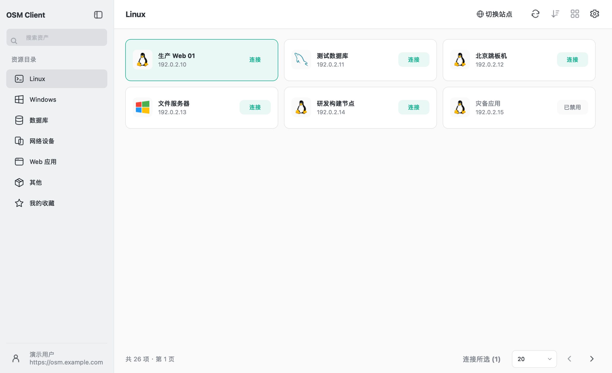

# OSMClient

独立的 Qt Widgets 桌面客户端。以 `clients` 的 `osm` 分支 `30edaf4a` 为迁移基线，Qt 5.15 为默认构建版本，同一套 C++17 源码支持 Qt 6。

保留原项目 `go-client/` 的协议启动实现、默认应用配置、PuTTY、AutoIt 和 macOS Scripts。Qt 负责原生界面、OAuth、授权资产与连接令牌；第三方客户端仍由 Go 启动器接收原始 `jms://` 链接后拉起。项目不依赖 WebView、Node 或 Rust。

## 功能

- 登录前站点版本兼容检查，浏览器 OAuth 授权码 + PKCE、`state` 校验、`jms://auth/callback`、刷新、注销、最近站点切换和恢复登录。
- 用户资料、组织权限、组织切换、授权资产分类、搜索、排序、分页、刷新、收藏和重命名。Windows 合并 AD 资产，“其他”合并 Unix/Other。
- 卡片/表格视图、侧栏折叠、快捷键、右键菜单、批量连接、已保存连接直连、连接编辑器、账号/协议/连接方式权限校验。
- 托管账号、手工输入账号、同名账号；服务端允许时将输入凭据保存到系统凭据库。
- SSH、Telnet、SFTP、RDP、VNC、数据库和 Web 应用连接沿用 Go 启动器；实际支持的客户端受原项目各系统实现及本机安装情况约束。
- 字符集、退格键、RDP 分辨率/全屏/多屏/磁盘映射、主题、字体、主题色、中英文、本地应用选择、版本信息、托盘和单实例。
- macOS/Windows/Linux 的 `jms://` 注册模板与平台凭据存储。

功能映射和差异见 [迁移说明](docs/migration.md)，实际测试见 [验证记录](docs/validation.md)，系统/架构规划见 [兼容性矩阵](docs/compatibility.md)。



界面沿用原 client 的紧凑资源浏览布局：灰色侧栏、单排图标工具栏、自适应横向资产卡和绿色连接按钮。登录、连接、设置与本地应用页使用统一的间距、圆角、线条图标及亮/暗主题；折叠侧栏后可从账户菜单切换站点或退出登录。

## 构建

需要 CMake ≥ 3.16、C++17 编译器、Qt Core/Gui/Widgets/Network/Svg/Test、Python ≥ 3.8 和 Go。Go 模块版本保持原项目，构建工具链应按目标系统选择。

推荐使用 `./build.sh` 生成安装包。当前 Apple Silicon 开发机的兼容 Qt 和 Go 路径如下（`/tmp` 可能被系统清理）：

```sh
./build.sh --platform macos --arch arm64 \
  --qt-prefix /tmp/osmclient-qt-arm64 \
  --go /Users/gerry/go/pkg/mod/golang.org/toolchain@v0.0.1-go1.21.13.darwin-arm64/bin/go
```

其他机器须替换成真实路径；下文 `/path/to/...` 均为占位符。Qt 前缀须包含 `lib/cmake/Qt5/Qt5Config.cmake`，且架构与最低系统版本必须匹配。Windows 正式构建应在 Windows 开发环境运行；本机交叉编译的 Windows 测试包需要额外验证，不能当成已通过 Windows 实机验收的发行包。

```sh
cmake -S . -B build-qt5 -DCLIENT_QT_MAJOR=5 -DCMAKE_PREFIX_PATH=/path/to/Qt/5.15/compiler
cmake --build build-qt5 --parallel
ctest --test-dir build-qt5 --output-on-failure
```

Qt 6 使用独立构建目录：

```sh
cmake -S . -B build-qt6 -DCLIENT_QT_MAJOR=6 -DCMAKE_PREFIX_PATH=/path/to/Qt/6/compiler
cmake --build build-qt6 --parallel
ctest --test-dir build-qt6 --output-on-failure
```

本机 Homebrew Qt 5 路径为 `/opt/homebrew/opt/qt@5`。分拆安装的 Homebrew Qt 6 可显式传入 `-DQt6_DIR=/opt/homebrew/lib/cmake/Qt6 -DQt6Svg_DIR=/opt/homebrew/lib/cmake/Qt6Svg -DCMAKE_PREFIX_PATH=/opt/homebrew`。不要在同一个构建目录切换 Qt 主版本。

Linux 安装对应发行版的 Qt 5 开发包、QtSvg、编译工具和 `libsecret-1-dev`（RPM 系通常为 `libsecret-devel`）。缺少 libsecret 时仍可使用当前登录会话，但不能持久保存凭据。桌面环境还须提供可用且已解锁的 Secret Service。

构建选项：

| 参数 | 用途 |
| --- | --- |
| `CLIENT_QT_MAJOR=5/6` | 选择 Qt 主版本 |
| `GO_EXECUTABLE=/path/to/go` | 为目标系统指定 Go 工具链 |
| `CLIENT_GOOS` / `CLIENT_GOARCH` | 交叉编译启动器，默认匹配 CMake 的目标系统/架构 |
| `CLIENT_BUILD_LAUNCHERS=OFF` | 仅构建 Qt 代码；此产物不能独立拉起连接 |
| `BUILD_TESTING=OFF` | 不构建测试程序 |

只交叉编译 Go 启动器不会生成对应平台的 Qt GUI。GUI 仍需要目标 Qt SDK、编译器和 sysroot。每个构建目录只产生一个目标架构。

运行：macOS 打开 `build-qt5/client-qt.app`，Windows 运行构建目录中的 `client.exe`，Linux 运行 `build-qt5/client-qt`。`--smoke-test` 使用临时设置，跳过真实凭据恢复，并自动退出。

## 登录与本地配置

安装包需先注册 `jms://`，才能从浏览器回到客户端。设置菜单与原 client 对齐，不再提供“高级”入口；既有本地回调的内部兼容能力保留。不要将账户密码或 token 写进命令行、源码或配置示例。

Qt 的界面设置存于 `FIT2CLOUD/client-qt` 的平台设置位置。Go 应用配置继续使用原 `jumpserver-client/config.json`，设置页的应用选择会同步影响使用同一配置的原客户端。配置合并保留已有应用路径/偏好，损坏的配置报错且不覆盖。

界面、系统应用显示名与安装器统一为 `OSMClient`。源码目录/构建目标 `client-qt`、既有配置与凭据标识保持稳定，改名不迁移或清空已有配置。

登录 token 与手工输入凭据保存在 macOS Keychain、Windows Credential Manager 或 Linux Secret Service。Qt 登录状态不导入原 Tauri 的凭据；首次使用需要登录。连接偏好按站点、用户、组织及资产隔离。

与原客户端一致，客户端发出的 HTTPS 请求默认忽略服务端证书校验（包括自签名、过期及主机名不匹配），覆盖版本检查、OAuth 令牌交换/刷新及业务 API。仍使用 HTTPS 加密，但不验证服务端证书身份；TLS 协议/握手失败及 HTTP 授权错误仍会报错。系统浏览器打开的 OAuth 授权页遵循浏览器自己的证书策略。

## 安装包与自动构建

安装包工具位于 `scripts/`，使用同一份 Qt/Go 源码，分别在目标平台构建：

| 安装包 | 脚本 | 构建环境 |
| --- | --- | --- |
| macOS `.dmg` | `package-macos.py` 部署运行库，`package-dmg.py` 生成安装盘 | macOS，匹配架构的 Qt SDK |
| Windows `.exe` / `.msi` | `package-windows.py --format both` | Windows，Qt SDK、NSIS、WiX 3、MSVC 或 MinGW |
| Debian/UOS `.deb` | `package-linux.py --format deb` | 对应 Debian 系发行版，Qt、dpkg-dev |
| Rocky/Kylin 等 `.rpm` | `package-linux.py --format rpm` | 对应 RPM 系发行版，Qt、rpm-build |

统一构建入口为 `./build.sh --help`，支持选择系统、架构、包格式、Qt/Go 工具链、版本和签名；完整参数及示例见 [Shell 构建入口](packaging/build-entry.md)。GitHub Actions 触发方式、矩阵与 Secrets 见 [CI 说明](packaging/ci.md)。每种架构独立出包。

工作流复用原 client 的 Apple 证书 Secrets，签署 Qt 程序和内嵌 Go 程序，随后签署、公证并装订 DMG 的公证票据。Windows 可选 PFX/Authenticode 签名。缺少证书或必要签名凭据时自动跳过签名并输出未签名安装包，macOS 同时跳过公证；状态写入日志和 manifest。工作流仅上传 Actions 制品，不自动发布 Release。

安装包格式不改变二进制最低系统要求。旧 Windows、macOS、UOS/麒麟及不同国产 CPU 需要匹配的 Qt、编译器、Go 工具链与原生发行版环境；详见 [兼容性矩阵](docs/compatibility.md)。

## 测试与发布

Qt Test 使用本地 HTTP mock、临时设置、模拟启动器和离线资产 fixture，不连接生产站点。默认不访问系统凭据库；可用 `CLIENT_QT_TEST_CREDENTIAL_STORE=1` 显式运行仅操作随机测试 key 的凭据往返用例。

```sh
QT_QPA_PLATFORM=offscreen CLIENT_QT_SCREENSHOT_DIR=/tmp/client-qt-ui ./build-qt5/test_ui
```

上述命令可导出测试资产界面截图。测试数据只存在于测试程序，主程序没有伪登录或假资产入口。

可在独立进程中复查不同显示缩放、语言、窗口宽度及字体大小：

```sh
python3 scripts/capture-ui.py --test-executable build-qt5/test_ui --output /tmp/client-qt-ui-scales
```

默认检查 100%、125%、150% 缩放并生成 HTML 截图索引；输出目录需为空，避免覆盖已有检查记录。

部署和协议注册见 [packaging/README.md](packaging/README.md)。本地构建与测试不代表已完成 Windows、UOS、麒麟及旧系统实机验收，也不代表完成签名、公证和正式安装包发布。
